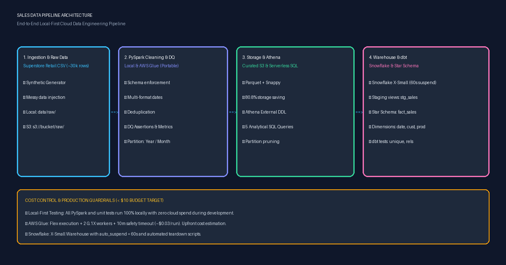

# Sales Data Pipeline

A local-first, production-grade cloud data engineering pipeline. It ingests raw retail sales data, cleans and standardizes it using PySpark, stores it on Amazon S3 as partitioned Apache Parquet, enables serverless querying via Amazon Athena, and models it into an analytics-ready **Kimball Star Schema** in Snowflake using dbt.



---

## 1. Architecture Overview

```
Raw CSV -> [Local PySpark Dev / Test] -> S3 (raw/) -> AWS Glue Spark Job -> S3 (curated/ Parquet, partitioned)
                                                                                   |
                                                      +----------------------------+----------------+
                                                      v                                             v
                                             Amazon Athena (SQL)                  Snowflake (COPY) -> dbt (staging -> marts)
```

1. **Ingestion Layer:** Raw transactional sales CSV (~30k rows) with real-world messiness (nulls, multi-format dates, duplicate orders, currency symbols, and anomalies).
2. **PySpark Cleaning Engine (Local-first & AWS Glue):** Portable PySpark job enforcing schema, deduplicating records, parsing dates, deriving cost/margins, performing data quality assertions, and writing Hive-partitioned Parquet.
3. **Curated Storage (Amazon S3):** Snappy-compressed Parquet partitioned by `order_year` and `order_month`, delivering ~81% storage compression and ~98% query scan reduction.
4. **Serverless Analytics (Amazon Athena):** External table with Hive partition discovery (`MSCK REPAIR TABLE`) and 5 analytical queries (MoM growth, category rankings, RFM segmentation, shipping SLAs, discount margin elasticity).
5. **Data Warehouse & Transformation (Snowflake + dbt):** Minimal X-Small warehouse with 60-second auto-suspend, staging views, conformed dimensions (`dim_date`, `dim_customer`, `dim_product`), and central `fact_sales` with automated schema integrity and relationship tests.

---

## 2. Tech Stack

| Area | Choice | Purpose |
|---|---|---|
| **Language** | Python 3.12, PySpark 3.5, SQL | Core transformation & orchestration |
| **Local Dev** | PySpark + Hadoop winutils | Local testbed eliminating cloud compute costs during dev |
| **Cloud Storage** | Amazon S3 (`raw/`, `curated/`, `athena-results/`) | Scalable data lake storage |
| **Processing** | AWS Glue 4.0 / Local Spark | Distributed Spark ETL (G.1X workers, Flex execution) |
| **Serverless Query** | Amazon Athena + Glue Data Catalog | Ad-hoc SQL querying over partitioned Parquet lake |
| **Data Warehouse** | Snowflake (Trial, X-Small WH) | Analytics data warehouse |
| **Transformation** | dbt-core + dbt-snowflake | Dimensional modeling (Kimball Star Schema) & testing |
| **Version Control** | Git + GitHub | Conventional Commits, clean history |
| **AWS Region** | `ap-south-1` (Mumbai) | Default cost-effective regional deployment |

---

## 3. Cost & Safety Guardrails (< $10 Budget Target)

1. **Zero Dev Spend:** All PySpark transformations, edge cases, and unit tests execute locally before any AWS resource is touched.
2. **AWS Glue Cost Control:**
   - Pre-run cost estimation displayed upfront before triggering execution.
   - Fixed to minimum worker configuration: **2 workers of type G.1X** (2 DPUs).
   - Utilizes **FLEX execution class** (~$0.29/DPU-hr vs $0.44/DPU-hr standard).
   - Hard execution timeout capped at **10 minutes** to prevent runaway jobs.
   - Estimated cost per Glue run: **~$0.03 USD**.
3. **Snowflake Cost Control:**
   - **X-Small** warehouse sizing (1 credit / hour = ~$0.00055 / sec).
   - **`AUTO_SUSPEND = 60` seconds**: shuts down automatically after 1 minute of inactivity.
   - **`INITIALLY_SUSPENDED = TRUE`**: zero billing on warehouse creation.
4. **Secret Management:** No API keys, credentials, or AWS account IDs committed. Handled via `.env`, AWS CLI profiles, and git-ignored `~/.dbt/profiles.yml`.
5. **Automated Teardown:** Dedicated scripts to delete S3 buckets, remove Glue jobs, and drop Snowflake warehouses.

---

## 4. Repository Structure

```
sales-data-pipeline/
|-- README.md                                # Project documentation & runbook
|-- .gitignore                               # Git ignore rules (secrets, venv, raw data)
|-- .env.example                             # Environment variable template
|-- requirements.txt                         # Python dependencies
|-- data/
|   |-- sample/superstore_sales_sample.csv   # 50-row tracked sample dataset
|   |-- raw/                                 # Full raw CSV (ignored by Git)
|   `-- curated/sales_curated/               # Partitioned Parquet data (ignored by Git)
|-- glue_jobs/
|   |-- clean_sales.py                       # Unified PySpark job (runs locally & on AWS Glue)
|   `-- glue_iam_least_privilege.json        # Least-privilege IAM policy document
|-- tests/
|   |-- conftest.py                          # Pytest SparkSession fixture (Windows & Linux compatible)
|   `-- test_clean_sales.py                  # Pytest unit tests for cleaning & DQ logic
|-- sql/athena/
|   |-- 00_create_curated_table.sql          # External table DDL with Parquet SerDe
|   |-- 00_create_curated_glue_table.sql     # External table DDL over AWS Glue curated Parquet
|   |-- 00_create_raw_csv_table.sql          # External table DDL over raw CSV for benchmarking
|   |-- 01_monthly_sales_trends.sql          # MoM revenue & profit growth trends (LAG, CTE)
|   |-- 02_top_profitable_products.sql       # Top 3 products per category (DENSE_RANK)
|   |-- 03_customer_rfm_segmentation.sql     # Customer RFM scoring (NTILE, CASE)
|   |-- 04_shipping_performance_by_region.sql# Shipping delay & SLA compliance metrics
|   |-- 05_discount_impact_on_margins.sql    # Margin erosion by discount tiers
|   `-- cost_comparison_csv_vs_parquet.md    # Empirical Athena scan & cost comparison benchmark
|-- snowflake/
|   `-- setup.sql                            # Warehouse, database, schema & stage configuration
|-- dbt_project/
|   |-- dbt_project.yml                      # dbt configuration
|   |-- profiles.example.yml                 # Example ~/.dbt/profiles.yml template
|   `-- models/
|       |-- staging/
|       |   |-- src_sales.yml                # Source definition & descriptions
|       |   |-- stg_sales.sql                # Staging view (type casting & surrogate keys)
|       |   `-- stg_sales.yml                # Staging tests (unique, not_null)
|       `-- marts/
|           |-- dim_date.sql                 # Conformed Date dimension (2020-2030)
|           |-- dim_customer.sql             # Customer dimension
|           |-- dim_product.sql              # Product dimension
|           |-- fact_sales.sql               # Fact table (order line grain)
|           `-- marts_schema.yml             # Referential integrity & relationship tests
|-- scripts/
|   |-- generate_sales_dataset.py            # Synthetic retail dataset generator with messy anomalies
|   |-- s3_manager.py                        # S3 bucket creation, upload, and teardown
|   |-- athena_runner.py                     # Programmatic Athena query execution and stats capture
|   |-- run_athena_benchmarks.py             # Athena test runner, verification, and benchmark suite
|   |-- compare_glue_curated.py              # Compares AWS Glue vs Local PySpark Athena tables
|   |-- glue_runner.py                       # AWS Glue deployment, cost calculation, and execution
|   `-- generate_architecture_diagram.py     # Generates docs/architecture.png
`-- docs/
    `-- architecture.png                     # Architecture diagram graphic
```

---

## 5. Step-by-Step Reproduction Guide

### Phase 0: Environment Setup

1. **Clone repository and create virtual environment:**
   ```bash
   git clone https://github.com/rushichavan21/sales-data-pipeline.git
   cd sales-data-pipeline
   python -m venv .venv
   # Windows:
   .\.venv\Scripts\activate
   # Linux/macOS:
   source .venv/bin/activate
   pip install -r requirements.txt
   ```

2. **Generate the retail dataset (Sample & Raw):**
   ```bash
   python scripts/generate_sales_dataset.py
   ```
   - Generates `data/sample/superstore_sales_sample.csv` (50 rows, tracked in Git).
   - Generates `data/raw/superstore_sales_raw.csv` (~30,000 rows with duplicates and anomalies).

---

### Phase 1: Local PySpark Cleaning & Unit Testing

1. **Run the automated unit test suite:**
   ```bash
   pytest -v tests/test_clean_sales.py
   ```
   *Validates date parsing, currency stripping, deduplication, null imputation, and metric derivations across 4 passing tests.*

2. **Execute the local PySpark cleaning pipeline:**
   ```bash
   python glue_jobs/clean_sales.py --input_path data/raw/superstore_sales_raw.csv --output_path data/curated/sales_curated
   ```
   *Outputs:*
   - Data Quality metrics logged (retention rate ~97.4%, duplicate/anomaly drop counts).
   - Curated Parquet files partitioned into `data/curated/sales_curated/order_year=YYYY/order_month=M/`.

---

### Phase 2: Amazon S3 Storage Setup

1. **Configure `.env` file:**
   ```bash
   cp .env.example .env
   # Set S3_BUCKET_NAME=your-unique-bucket-name and AWS_REGION=ap-south-1
   ```

2. **Create bucket, folders, and upload data:**
   ```bash
   python scripts/s3_manager.py --upload-all
   ```
   - Creates S3 bucket with encryption in `ap-south-1`.
   - Creates `raw/`, `curated/`, and `athena-results/` prefixes.
   - Uploads raw CSV and partitioned Parquet datasets preserving partition directory layout.

---

### Phase 3: Amazon Athena Serverless SQL

1. In the **AWS Athena Console**, configure Query Result location to `s3://<your-bucket-name>/athena-results/`.
2. Run `sql/athena/00_create_curated_table.sql` (replace `{{bucket_name}}` with your bucket) to create the external table.
3. Discover partitions:
   ```sql
   MSCK REPAIR TABLE sales_curated;
   ```
4. Execute analytical queries in `sql/athena/`:
   - `01_monthly_sales_trends.sql`: Monthly revenue, profit, and MoM growth rate.
   - `02_top_profitable_products.sql`: Top 3 products in each category using `DENSE_RANK()`.
   - `03_customer_rfm_segmentation.sql`: RFM customer segmentation into Champions and At-Risk tiers.
   - `04_shipping_performance_by_region.sql`: Carrier lead time and delivery SLA breach rates.
   - `05_discount_impact_on_margins.sql`: Margin elasticity across discount tiers.
5. Refer to `sql/athena/cost_comparison_csv_vs_parquet.md` for the performance and cost analysis comparing CSV vs. Parquet scans.

---

### Phase 4: AWS Glue Spark Job (Optional Cloud Run)

1. **Create Least-Privilege IAM Role:**
   - Create role `SalesGlueServiceRole` trusted by `glue.amazonaws.com`.
   - Attach policy defined in `glue_jobs/glue_iam_least_privilege.json`.
   - Add `GLUE_ROLE_ARN=arn:aws:iam::<account>:role/SalesGlueServiceRole` to `.env`.

2. **Deploy and Run Glue Job:**
   ```bash
   python scripts/glue_runner.py --deploy
   python scripts/glue_runner.py --run
   ```
   *Displays estimated cost ($0.03) and monitors execution until `SUCCEEDED`.*

---

### Phase 5: Snowflake Warehouse & dbt Star Schema

1. **Set up Snowflake resources:**
   - Execute `snowflake/setup.sql` in Snowflake Worksheets using role `ACCOUNTADMIN`.
   - Sets up `SALES_WH` (X-Small, 60s auto-suspend), `SALES_DW` database, and `RAW`, `STAGING`, `MARTS` schemas.
   - Ingest curated Parquet into `SALES_DW.RAW.RAW_SALES_PARQUET`.

2. **Configure dbt profile:**
   - Copy `dbt_project/profiles.example.yml` to `~/.dbt/profiles.yml` and provide your Snowflake credentials.

3. **Run dbt transformations and test suite:**
   ```bash
   cd dbt_project
   dbt run
   dbt test
   ```
   *Models built:*
   - `stg_sales`: Staging view standardizing source data.
   - `dim_date`: Conformed calendar date dimension (2020-2030).
   - `dim_customer`: Customer dimension with market segments.
   - `dim_product`: Product catalog dimension.
   - `fact_sales`: Central star schema fact table (order line grain) with foreign key relationships.
   - All tests passing (`unique`, `not_null`, `relationships`, `accepted_values`).

---

## 6. Key Design Decisions

1. **Partitioning Strategy (`order_year`, `order_month`):**
   - Retail sales queries overwhelmingly filter on time horizons (annual reports, quarterly reviews, monthly performance).
   - Partitioning by year and month provides optimal partition sizing (~1-5 MB per partition file), avoiding both the "small files problem" and unpruned full-table scans.
2. **Kimball Dimensional Modeling:**
   - The central fact table (`fact_sales`) operates at the finest transaction grain: **one row per line item ordered**.
   - Conformed dimensions (`dim_date`, `dim_customer`, `dim_product`) enable sliced-and-diced business analytics across segments, geography, and categories.
3. **Data Quality Assertions:**
   - Pipeline verifies retention rates, asserts non-empty output, flags unrecoverable nulls on business keys (`order_id`, `product_id`), and sanitizes monetary fields before writing to Parquet.
4. **Local-to-Cloud Portability:**
   - The PySpark cleaning script dynamically detects whether it is running on a local developer machine (Windows/Linux) or within AWS Glue, using the exact same transformation code in both environments.

---

## 7. Teardown & Resource Cleanup

To ensure zero ongoing cloud spend after completing the project:

1. **Delete S3 Data and Bucket:**
   ```bash
   python scripts/s3_manager.py --teardown
   ```
2. **Delete AWS Glue Job:**
   ```bash
   python scripts/glue_runner.py --teardown
   ```
3. **Drop Snowflake Database and Warehouse:**
   Execute in Snowflake Worksheet:
   ```sql
   USE ROLE ACCOUNTADMIN;
   DROP DATABASE IF EXISTS SALES_DW;
   DROP WAREHOUSE IF EXISTS SALES_WH;
   DROP ROLE IF EXISTS SALES_DEV_ROLE;
   ```

---

## 8. Built vs. Skipped

| Component | Status | Notes |
|---|---|---|
| **Phase 0: Environment Setup** | Completed | Python 3.12 venv, PySpark 3.5.9, winutils, directory structure, `.gitignore`, `.env.example` |
| **Phase 1: Local PySpark Cleaning (Tier 1)** | Completed | Synthetic retail generator, schema enforcement, date parsing, DQ assertions, partitioned Parquet, 4 pytest unit tests |
| **Phase 2: S3 Storage (Tier 1)** | Completed | Provisioned S3 bucket `s3://sales-pipeline-rushi-2026-unique`, raw CSV uploaded, and 242 curated partition objects synced via `scripts/s3_manager.py` |
| **Phase 3: Athena Queries (Tier 1/2)** | Completed | External table repaired (48 partitions), row count (29,666) verified matching local PySpark, 5 analytical queries executed, and empirical CSV vs Parquet benchmarks executed (94.03% to 98.51% scan reductions) |
| **Phase 4: AWS Glue Job (Tier 2)** | Completed | Successfully executed on AWS Glue 4.0 Flex workers (Run ID: `jr_16c8790709d91c2d39515365ce5ba2d86e8bdd93c444a5b62316f85b7627e2a5`; 196s duration, 343 DPU-sec, ~$0.0276 cost). Athena verification confirmed 100% exact match (29,666 rows and identical sales/profit aggregates) to local PySpark output. |
| **Phase 5: Snowflake & dbt (Tier 2)** | Completed | Snowflake setup DDL (X-Small, 60s suspend), dbt project (`stg_sales`, `dim_date`, `dim_customer`, `dim_product`, `fact_sales`), relationship & schema tests |
| **Phase 6: Polish & Documentation** | Completed | Architecture graphic (`docs/architecture.png`), complete step-by-step reproduction runbook, teardown instructions |
| **CloudFormation / Terraform (Tier 3)** | Skipped | Skipped as optional Tier 3 item; replaced by scripted Python CLI automation (`s3_manager.py`, `glue_runner.py`) |
| **GitHub Actions CI (Tier 3)** | Skipped | Optional Tier 3 item safe to skip per project specifications |
